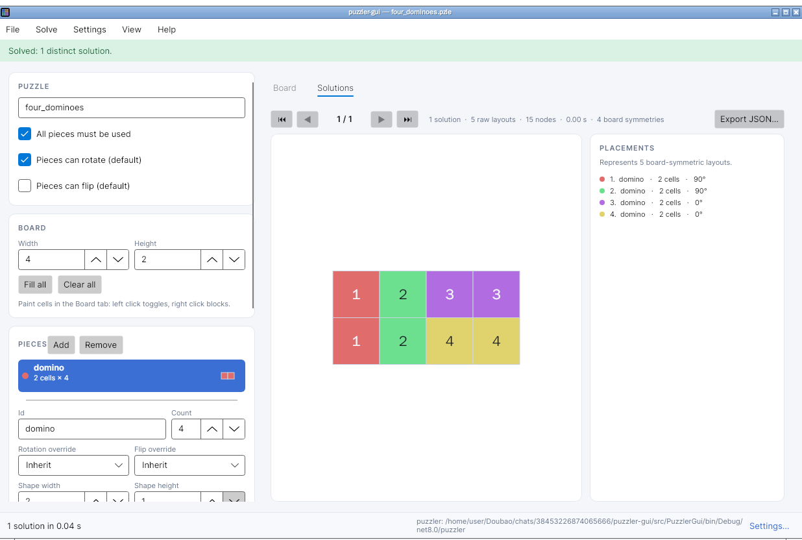

# puzzler-gui

A cross-platform desktop front-end for **puzzler**, the exact-cover solver for
polyomino and jigsaw-style puzzles. Build a `.pzle` puzzle visually, run the
solver, and flip through every distinct tiling without touching a terminal.



## Features

- **Board editor** — resize the board, paint playable cells, fill or clear the
  whole board in one click. The board surface is drawn as a crisp grid that
  follows the light or dark theme.
- **Piece editor** — draw each piece cell by cell, rotate it left or right,
  mirror it, trim empty borders, change its count, and override rotation or
  flipping per piece. Every piece type gets its own colour.
- **Real `.pzle` files** — opens the YAML dialect used by puzzler, including the
  `puzzle:` wrapper and the flat `- key: value` form, `rectangle{w,h}` boards and
  ASCII board/shape blocks. Saving writes a canonical, human-readable file.
- **Solver integration** — calls the `puzzler` executable with the current
  puzzle and passes through the solution limit, node limit, time limit, colour
  seed, symmetry-deduplication switch and the compact-JSON (`--compress`)
  option. The UI stays responsive, shows elapsed time, and can cancel a long
  search (the whole process tree is killed).
- **Solution browser** — every distinct solution is rendered on the solution
  canvas with a colour and number per placement, next to a placement list with
  rotation and flip information. First / previous / next / last navigation with
  Home / End and ← / → keys, plus JSON export of the full solver report.
- **Desktop conveniences** — open files by drag and drop or from the command
  line, recent files, Ctrl+N/O/S and Ctrl+Shift+S shortcuts, F5 to solve, Esc to
  cancel, an unsaved-changes prompt, light/dark/system themes, and a settings
  dialog for locating the solver.

## Requirements

- [.NET 8 SDK](https://dotnet.microsoft.com/download) (or the self-contained
  release archives, which need no runtime installed).
- The **puzzler** command-line program. Release archives of this GUI already
  bundle a matching solver; when building from source, either put `puzzler`
  next to the application or select it in **Settings → Solver**.

The GUI looks for the solver in this order:

1. the path saved in Settings,
2. the `PUZZLER_PATH` environment variable,
3. `puzzler` (`puzzler.exe` on Windows) next to the application,
4. `puzzler` on `PATH`.

## Build and run

```bash
dotnet build PuzzlerGui.sln -c Release
dotnet test tests/PuzzlerGui.Tests/PuzzlerGui.Tests.csproj
dotnet run --project src/PuzzlerGui
```

Open a puzzle directly:

```bash
dotnet run --project src/PuzzlerGui -- samples/four_dominoes.pzle
```

`PuzzlerGui.sln` opens in Visual Studio, Rider, or VS Code with the C# Dev Kit.
The application project targets `net8.0` and uses Avalonia 11 with compiled
bindings; the test project is a plain xUnit project.

Tests that need a real solver read the `PUZZLER_BIN` environment variable and
are skipped when it is not set:

```bash
PUZZLER_BIN=/path/to/puzzler dotnet test
```

## Releases

Tagged builds (`v*`) publish self-contained archives for:

| Platform | Runtime identifier |
| --- | --- |
| Windows x64 | `win-x64` |
| Linux x64 | `linux-x64` |
| macOS Intel | `osx-x64` |
| macOS Apple silicon | `osx-arm64` |

Each archive contains the GUI, the `puzzler` solver for that platform, the
sample puzzles and `SHA256SUMS.txt` is attached to the release. The release
workflow builds the solver from the companion repository
[HFunction2013/puzzler](https://github.com/HFunction2013/puzzler).

## Keyboard shortcuts

| Shortcut | Action |
| --- | --- |
| `Ctrl+N` | New puzzle |
| `Ctrl+O` | Open `.pzle` |
| `Ctrl+S` | Save |
| `Ctrl+Shift+S` | Save as |
| `F5` | Solve |
| `Esc` | Cancel the running search |
| `←` / `→` | Previous / next solution |
| `Home` / `End` | First / last solution |
| `Alt+F` / `Alt+S` / `Alt+E` / `Alt+V` / `Alt+H` | Open File / Solve / Settings / View / Help menu |

## Puzzle format

The solver consumes a small YAML dialect. This repository ships ten examples in
[`samples/`](samples); the minimal shape is:

```yaml
puzzle:
  name: "four dominoes"
  all_use: true
  can_rotate: true
  can_flip: false
  board_shape: rectangle{4,2}
  pieces:
    - id: "domino"
      shape: |
        ##
      count: 4
```

## License

MIT — see [LICENSE](LICENSE).
